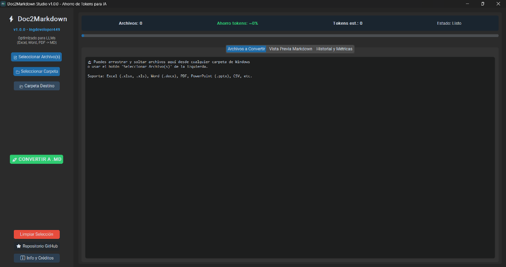
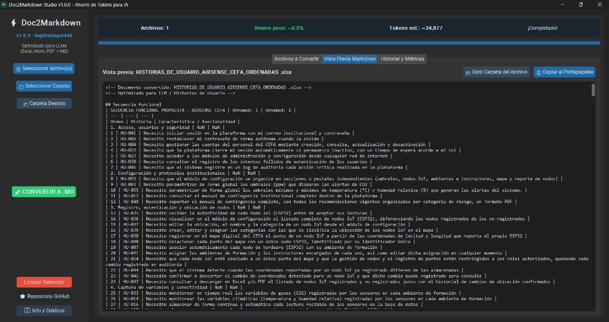
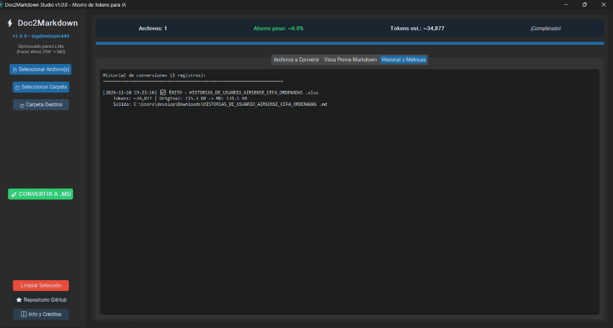
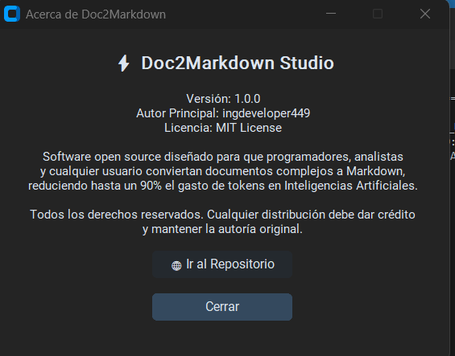

# ⚡ Doc2Markdown Studio

> **Convierte documentos complejos (Excel, Word, PDF, PowerPoint) a Markdown (.md) limpio con un solo clic.**  
> Diseñado para que **cualquier persona** (analistas de requerimientos, estudiantes, investigadores, docentes y programadores) ahorre miles de tokens y dinero al interactuar con Inteligencias Artificiales como ChatGPT, Claude, Gemini o DeepSeek.

---

## 🛑 La Problemática

Hoy en día, las herramientas de Inteligencia Artificial (LLMs) son el asistente diario de millones de profesionales y estudiantes. Sin embargo, surge un gran problema al compartirles información:

1. **Desperdicio masivo de tokens**: Cuando subes un archivo en formato **Excel (`.xlsx`, `.xls`)**, **Word (`.docx`)** o **PDF**, más del **85% del archivo no es texto útil**, sino código XML binario, hojas de estilos, colores de celdas, fuentes tipográficas y propiedades de márgenes que la IA se ve obligada a leer.
2. **Límite de memoria (Context Window) saturado**: Al consumir tantos tokens en ruido visual, la IA rápidamente alcanza su límite de contexto, se satura o empieza a "alucinar" y olvidar instrucciones previas.
3. **Costo elevado en APIs y servicios**: En modelos de pago por consumo de tokens, estás pagando dinero real por procesar colores y celdas vacías en lugar de información valiosa.
4. **Complejidad técnica**: Para los usuarios no técnicos, convertir archivos a formatos limpios suele requerir instalar repositorios complejos, terminales de comandos o herramientas de pago en la nube.

---

## 💡 Nuestra Solución: Doc2Markdown Studio

**Doc2Markdown Studio** es una aplicación de escritorio moderna, visual e intuitiva que extrae únicamente el contenido semántico y los datos reales del documento, transformándolos instantáneamente en **Markdown (`.md`) nativo**: tablas limpias, encabezados estructurados y listas sin ruido.

- 📉 **Ahorro de hasta el 90% en tokens** para la IA.
- 🎯 **Respuestas mucho más precisas**, ya que la IA se concentra al 100% en los datos y no en el diseño.
- 🖱️ **Zero-Code / Cero Comandos**: Arrastra tu documento desde cualquier carpeta de Windows y pulsa un botón.

---

## 🖥️ Recorrido Visual de la Aplicación

### 1. Pantalla Principal y Carga Intuitiva

Puedes seleccionar archivos individuales, carpetas completas o simplemente **arrastrar y soltar** tus documentos directamente desde el explorador de Windows:

---

### 2. Conversión Rápida y Vista Previa en Vivo

El sistema procesa el documento en milisegundos y muestra de inmediato el Markdown estructurado en tablas legibles, listo para ser revisado:

> **Botones de acción inmediata:**
>
> - **`📋 Copiar al Portapapeles`**: Copia todo el contenido para pegarlo directamente en tu chat de IA sin abrir el archivo.
> - **`📂 Abrir Carpeta del Archivo`**: Abre el explorador de Windows señalando el archivo `.md` generado.

---

### 3. Historial de Conversiones y Métricas de Tokens

Monitorea tus conversiones con estimación de tokens y tamaño ahorrado para tener un control claro del rendimiento:

---

### 4. Información, Créditos y Repositorio Oficial

Accede a la ventana de información con la versión actual, términos de licencia y enlace directo al repositorio:

---

## 👥 ¿A quién le sirve esta herramienta?

- 📊 **Analistas de Sistemas y Requerimientos**: Transforma matrices de historias de usuario, casos de uso y catálogos de requisitos en tablas `.md` livianas para la IA.
- 🏢 **Equipos de Oficina y Gestión**: Convierte listados de asistencia, inventarios o cotizaciones de Excel a formato amigable para cualquier modelo LLM.
- 🎓 **Docentes y Estudiantes**: Limpia reportes, libros o guías académicas para pedir resúmenes precisos a ChatGPT o Gemini.
- 💻 **Desarrolladores**: Integra documentación sin lidiar con formatos propietarios ni consumo excesivo de tokens en prompts.

---

## 📥 Cómo Instalar y Usar la Aplicación (.exe)

No necesitas tener conocimientos técnicos ni tener Python instalado en tu equipo.

### Paso 1: Descargar el Ejecutable

1. Ve a la sección de [Última Versión (Releases)](https://github.com/ingdevelopers449/markitdownDocsDev/releases).
2. En la sección **Assets**, descarga el archivo **`Doc2Markdown.exe`**.

### Paso 2: Abrir el Software

1. Haz doble clic sobre **`Doc2Markdown.exe`**.
2. La aplicación se abrirá de inmediato en tu pantalla con su diseño moderno en modo oscuro.

### Paso 3: Convertir y Copiar a tu IA

1. Haz clic en **`📄 Seleccionar Archivo(s)`** (o arrastra tu documento de Excel, Word o PDF sobre la ventana).
2. Haz clic en el botón verde **`🚀 CONVERTIR A .MD`**.
3. En la pestaña **Vista Previa Markdown**, haz clic en **`📋 Copiar al Portapapeles`**.
4. ¡Pégalo en tu IA favorita (ChatGPT, Claude, Gemini, DeepSeek) y disfruta de respuestas rápidas sin desperdicio de tokens!

---

## 📄 Formatos Compatibles Soportados

El motor detecta automáticamente la estructura real de tu archivo gracias a su sistema de auto-detección inteligente:

- **Hojas de cálculo**: `.xlsx`, `.xls` (versiones modernas y antiguas), `.csv`
- **Documentos de texto**: `.docx`, `.pdf`, `.txt`
- **Presentaciones**: `.pptx`
- **Archivos web y estructurados**: `.html`, `.htm`, `.json`, `.xml`

---

## ⚖️ Licencia y Créditos de Autoría

Este proyecto es de código abierto bajo la licencia **MIT**.

- **Autor Principal**: [ingdeveloper449](https://github.com/ingdevelopers449)
- **Repositorio Oficial**: [https://github.com/ingdevelopers449/markitdownDocsDev](https://github.com/ingdevelopers449/markitdownDocsDev)

> [!IMPORTANT]
> **Atribución Requerida**: Cualquier persona u organización que clone, bifurque (*fork*), redistribuya o reutilice este software o su código fuente **debe conservar de manera visible los créditos correspondientes a su autor original (ingdeveloper449)** y el archivo [`LICENSE`](LICENSE) intacto.
